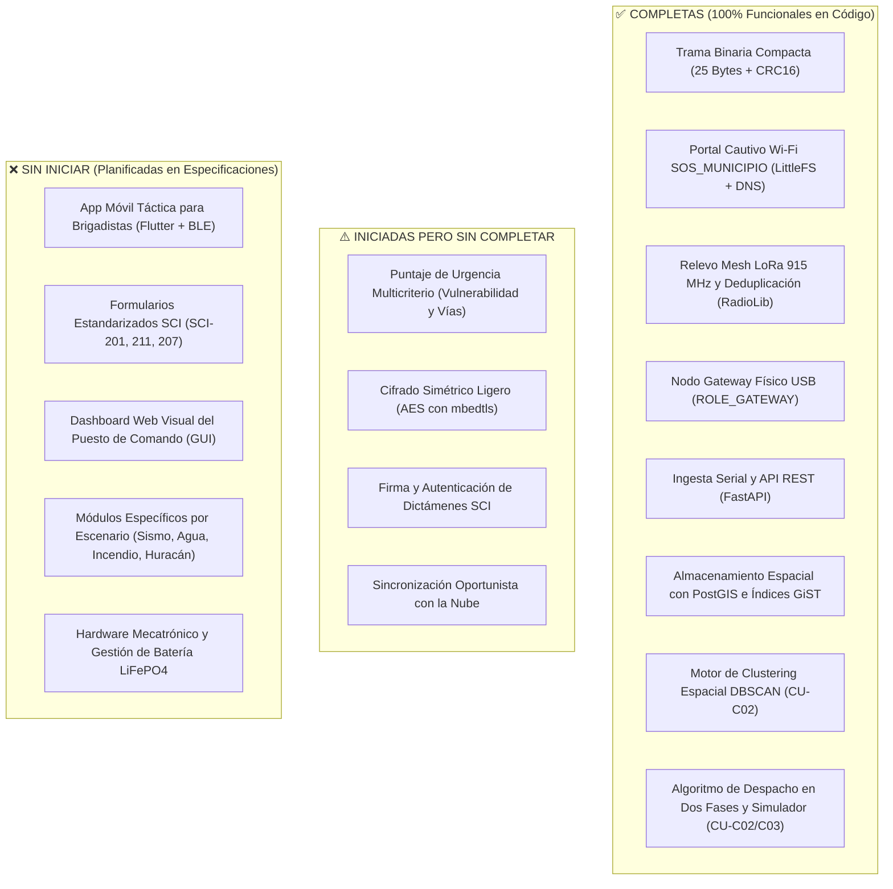

# Informe de Revisión Documental y Estado de Implementación: STG-AA

* **Proyecto:** Sistema de Triaje Georreferenciado y Asignación Algorítmica (STG-AA)
* **Equipo:** 404 skill not found
* **Sede:** Instituto Tecnológico Superior del Sur de Guanajuato
* **Desafío Atendido:** 09 - Optimización y priorización de recursos y esfuerzos en la post-emergencia
* **Fecha de Evaluación:** 16 de octubre de 2026

---

## 1. Dictamen de Revisión Documental

Se realizó un análisis comparativo y de consistencia técnica entre los dos documentos rectores del proyecto:
1. `especificaciones_y_casos_de_uso_stg_aa (1).md`
2. `propuesta_tecnologica_stg_aa (1).md`

### 1.1 Coherencia Conceptual y Metodológica
* **Alineación con el Desafío 09:** Ambos documentos mantienen una visión estricta y enfocada en resolver el colapso de las telecomunicaciones y la saturación informativa durante las primeras $72\text{ horas}$ de una catástrofe.
* **Consistencia de la Arquitectura de Captura Dual:**
  * **Nivel 1 (Ciudadano):** Portal Cautivo Wi-Fi (`"SOS_MUNICIPIO"`) en microcontroladores `ESP32` sin requerimiento de internet ni aplicaciones previas.
  * **Nivel 2 (Brigadista):** App móvil offline enlazada vía BLE a un nodo LoRa portátil para dictámenes normados bajo el estándar del Sistema de Comando de Incidentes (SCI).
  * **Puesto de Comando (PC):** Servidor táctico local (`FastAPI` + `PostGIS`) conectado por USB a un nodo Gateway para procesamiento autónomo sin dependencia de la nube.
* **Fórmula de Despacho en Dos Fases:** Ambos documentos sostienen con claridad la distinción fundamental del sistema: las alertas ciudadanas preliminares se unifican mediante clustering espacial y despachan misiones de **Reconocimiento**, mientras que los dictámenes verificados por brigadistas elevan el puntaje de urgencia y despachan **Fuerza de Tarea**.

### 1.2 Observaciones Técnicas y Ajustes Recomendados
A fin de optimizar la sustentación ante el comité evaluador y evitar inconsistencias en el repositorio:

1. **Persistencia Móvil (WatermelonDB vs. SQLite en Flutter):**
   * *Hallazgo:* En la tabla de la propuesta tecnológica se lista `Flutter + Dart` con `WatermelonDB / SQLite`.
   * *Aclaración Técnica:* `WatermelonDB` es una base de datos diseñada para ecosistemas JavaScript/React Native. Dado que el frontend móvil de brigadistas se proyecta en **Flutter**, la biblioteca estándar y óptima para persistencia reactiva offline-first es **SQLite** (a través de paquetes como `sqflite` o `drift`). Se sugiere uniformar la redacción a `SQLite (drift / sqflite)`.
2. **Protocolo de Malla (Meshtastic vs. Malla Ligera Propietaria sobre RadioLib):**
   * *Hallazgo:* La propuesta menciona *"Firmware basado en Meshtastic / Tramas Binarias"*.
   * *Aclaración Técnica:* El código fuente implementado en `firmware/` utiliza un protocolo punto a punto / relevo en malla propio implementado directamente sobre **RadioLib**, con paquetes compactos de 25 bytes y deduplicación por `(node_id, seq)`. Esto representa una ventaja técnica significativa frente a Meshtastic, ya que evita la sobrecarga de memoria y procesamiento de su stack completo, permitiendo que el servidor web asíncrono y el portal cautivo convivan de forma estable en el mismo microcontrolador. Se recomienda indicar en la propuesta: *"Protocolo de malla ultraligero implementado con RadioLib"*.
3. **Optimización del Presupuesto de Trama:**
   * *Hallazgo:* Los documentos fijan un límite máximo de trama de $< 200\text{ bytes}$.
   * *Logro Actual:* La trama binaria implementada mide exactamente **25 bytes**, aprovechando apenas el $12.5\%$ del límite establecido, reduciendo drásticamente el tiempo en el aire (*Time-on-Air*) y minimizando la probabilidad de colisiones en la banda de $915\text{ MHz}$.

---

## 2. Inventario y Estado de Implementación de Features

El estado se clasificó tras auditar el repositorio local (`backend/`, `firmware/`, configuración y pruebas).

---

### 2.1 Features Completas (100% Implementadas y Verificadas)

| Feature / Módulo | Caso de Uso / Spec | Archivos de Implementación | Descripción y Evidencia |
| :--- | :--- | :--- | :--- |
| **Protocolo de Trama Binaria (25B)** | Spec 1.1 / Flujo Etapa 2 | `firmware/include/frame.h` `backend/app/frame.py` `firmware/tools/frame_check.cpp` `backend/tests/test_frame.py` | Codificación/decodificación binaria idéntica en C++ y Python. Paquete de 25 bytes: versión, flags (`FLAG_BRIGADISTA`, `FLAG_PRIORITY`), tipo de incidente, TTL, ID de nodo, secuencia, timestamp, coordenadas escaladas ($10^6$), severidad, afectados y CRC16-CCITT. Paridad verificada mediante vector dorado. |
| **Portal Cautivo Ciudadano (`SOS_MUNICIPIO`)** | CU-C01 / Spec 1.1 / Spec 1.3 | `firmware/src/portal.cpp` `firmware/src/portal.h` `firmware/data/index.html` | Red Wi-Fi abierta sin requerimiento de internet. DNS Server captivo redirigiendo consultas del sistema operativo (`/generate_204`, etc.). UI web táctica en modo oscuro almacenada en `LittleFS`, lectura de geolocalización HTML5 y envío asíncrono a cola FreeRTOS. |
| **Malla LoRa y Deduplicación en Nodo** | Spec 1.1 / Flujo Etapa 3 | `firmware/src/main.cpp` `firmware/src/radio_link.cpp` `firmware/include/config.h` | Radio SX1262 a $915\text{ MHz}$ (SF9, BW 125 kHz, CR 4/7). Buffer circular de 64 entradas para deduplicación por `(node_id, seq)`, retransmisión (*relay*) con decremento de TTL y retardo aleatorio de prevención de colisiones (50-400 ms). |
| **Firmware Gateway USB** | Spec 1.1 / Flujo Etapa 4 | `firmware/src/main.cpp` `firmware/platformio.ini` | Perfil de compilación `[env:gateway]`. Escucha tramas aéreas LoRa y las imprime en formato texto estructurado `FRAME <hex>\n` a través del puerto serie USB hacia el Puesto de Comando. |
| **Ingesta Serial y API Táctica** | Spec 1.1 / Spec 1.2 | `backend/app/ingest.py` `backend/app/main.py` `backend/app/config.py` | Hilo demonio con `PySerial` y reconexión automática ante reconexión física del Gateway. Endpoints REST `GET /health`, `POST /ingest/frame` y `GET /clusters`. |
| **Base de Datos Espacial PostGIS** | Spec 1.2 / Flujo Etapa 5 | `backend/app/db.py` `backend/app/repository.py` `docker-compose.yml` | Despliegue en contenedor con PostGIS 16-3.4. Tabla `reports` con columna espacial `geometry(Point, 4326)`, índice GiST, índice temporal y clave única contra duplicados `(node_id, seq, node_time)`. |
| **Clustering Espacial DBSCAN** | CU-C02 / Spec 1.2 | `backend/app/clustering.py` `backend/app/service.py` `backend/tests/test_clustering.py` | Algoritmo `DBSCAN` usando métrica `haversine` sobre radio terrestre. Agrupa reportes cercanos en una misma zona (80 m) en un único clúster con centroide geográfico y consolidación de afectados y tipos de siniestro. |
| **Despacho Algorítmico y Simulador** | CU-C02 / CU-C03 / Flujo 5 | `backend/app/scoring.py` `backend/sim/simulator.py` `backend/tests/test_scoring.py` | Ponderación de densidad ciudadana vs dictamen verificado. Sugiere `RECONOCIMIENTO` ante alertas ciudadanas de alta incertidumbre y escala automáticamente a `FUERZA_TAREA` al registrarse un dictamen SCI. El simulador reproduce ráfagas de 18 alertas y verificación táctica. |

---

### 2.2 Features Iniciadas pero sin Completar

| Feature | Descripción del Trabajo Existente | Brecha para Completar |
| :--- | :--- | :--- |
| **Puntaje de Urgencia Multicriterio Completo** | La fórmula matemática en `backend/app/scoring.py` ya incluye los pesos `W_VULNERABILITY` (10%) y `W_ROAD_PENALTY` (15%). | En `backend/app/service.py` los valores se pasan fijos en `0.0`. Falta implementar las consultas PostGIS que crucen la posición del clúster con capas de infraestructura crítica (hospitales, escuelas) y bloqueos viales reportados. |
| **Cifrado Simétrico Ligero (AES)** | Se define en especificaciones y en la cabecera de trama binaria. | Falta implementar el módulo de cifrado AES (utilizando `mbedtls` en el ESP32 y `cryptography` en Python) antes de la transmisión de la trama por radio LoRa. |
| **Firma Criptográfica para Brigadistas** | El sistema valida la bandera lógica `FLAG_BRIGADISTA = 0x01` para priorizar eventos sobre alertas ciudadanas. | Falta una firma HMAC o token criptográfico que garantice que una trama con bandera de brigadista proviene auténticamente de un rescatista acreditado y no de una inyección arbitraria. |
| **Sincronización Oportunista con la Nube** | El Puesto de Comando opera de forma $100\%$ local y aislada. | Falta programar el servicio de sincronización en segundo plano que replique periódicamente los clústeres hacia una API central cuando se detecte enlace satelital o conexión 4G/5G de respaldo. |

---

### 2.3 Features Sin Iniciar (Fase de Diseño y Especificación)

| Área / Feature | Casos de Uso | Alcance Pendiente de Implementación |
| :--- | :--- | :--- |
| **App Móvil Táctica para Brigadistas** | CU-G01 a CU-G05 | Creación del proyecto en `Flutter + Dart`. Integración de comunicación BLE con `flutter_blue_plus` hacia el nodo LoRa. Base de datos local SQLite para persistencia sin conexión. Interfaz de alto contraste (botones $\ge 60\times 60\text{ dp}$ adaptados a guantes) y dictado por voz offline. |
| **Formularios Digitales SCI** | CU-G01 (SCI-201) CU-G02 (SCI-211) CU-G04 (SCI-207) | * **SCI-201:** Resumen del incidente, asunción de mando, perímetro de seguridad e instalaciones iniciales (`PC`, `E`). * **SCI-211:** Registro de recursos por Clase, Tipo (1 a 4), Categoría y Estado (*Disponible*, *Asignado*, *No Disponible*). * **SCI-207:** Triaje médico en el Área de Concentración de Víctimas (`ACV`) con código de colores START (Rojo, Amarillo, Verde, Negro). |
| **Gestión de Alcance de Control** | CU-G03 | Algoritmo y alertas visuales en el Puesto de Comando cuando un supervisor supere la relación normativa de $3\text{ a }7$ subordinados (óptimo de $5$). |
| **Transferencia de Mando Digital** | CU-G05 | Flujo de relevo de autoridad cara a cara mediante código QR o proximidad BLE entre el Comandante saliente y el entrante. |
| **Dashboard Visual Puesto de Comando (GUI)** | Spec 1.2 / CU-C02 | Interfaz gráfica de usuario en navegador web para la laptop del Comandante: mapa interactivo con simbología SCI normada (rectángulo naranja `PC`, círculo amarillo `E`, `ACV`, `B`, `C`, `H1`), mapa de calor espacial y cola de despacho. |
| **Módulos Específicos por Catástrofe** | CU-T01 a T03 (Sismos) CU-A01 a A03 (Agua) CU-I01 a I03 (Fuego) CU-H01 a H03 (Huracán) | Lógica especializada para: * Etiquetado estructural post-sismo (Verde, Amarillo, Rojo). * Despacho de bombas de achique y cercos sanitarios en inundaciones. * Vector de viento y brechas cortafuego en incendios. * Monitoreo de porcentaje de víveres en refugios y orden global de resguardo obligatorio durante huracanes. |
| **Hardware Mecatrónico y Energía** | Spec 1.3 / Stack | Modelado e impresión 3D de carcasas de polímero térmicamente resistentes. Circuito de carga y telemetría de baterías de $\text{LiFePO}_4$ con celda solar de $5\text{ W}-10\text{ W}$ y conmutación a modos *Deep-Sleep*. |

---

## 3. Matriz Consolidada de Madurez del Proyecto

| Componente del Sistema | Estado | Madurez | Prioridad Inmediata |
| :--- | :---: | :---: | :---: |
| **Protocolo y Serialización Binaria (25B)** | Completa | $100\%$ | Ninguna (Cerrado y verificado) |
| **Portal Cautivo Ciudadano (`ESP32`)** | Completa | $100\%$ | Pruebas de campo en smartphone |
| **Malla LoRa y Gateway USB (`SX1262`)** | Completa | $100\%$ | Pruebas de alcance por salto |
| **Backend Táctico (`FastAPI` + `PostGIS`)** | Completa | $90\%$ | Conectar variables viales y vulnerabilidad |
| **Clustering y Despacho en Dos Fases** | Completa | $100\%$ | Validado con simulador |
| **Puntaje Multicriterio Vial/Vulnerabilidad** | Iniciada | $30\%$ | Cargar capas GIS de infraestructura |
| **Seguridad y Cifrado de Tramas** | Iniciada | $20\%$ | Implementar AES en firmware y backend |
| **Dashboard Web Táctico (PC)** | Sin Iniciar | $0\%$ | Desarrollar frontend Leaflet / Mapbox |
| **App Móvil de Brigadistas (Flutter)** | Sin Iniciar | $0\%$ | Iniciar proyecto Flutter y módulo BLE |
| **Formularios SCI (201, 211, 207)** | Sin Iniciar | $0\%$ | Diseñar modelos de datos e interfaces |

---

## 4. Hoja de Ruta Sugerida (Próximos Pasos)

1. **Paso 1 — Dashboard Web del Puesto de Comando:** Desarrollar una interfaz frontend ligera (HTML5/React/Vue con Leaflet) que consuma el endpoint existente `GET /clusters`, renderizando los pines con la simbología SCI normada (`PC`, `E`, `ACV`) y el polígono de calor de reportes ciudadanos.
2. **Paso 2 — Completar el Puntaje Multicriterio:** Crear en `PostGIS` una tabla simple de vías bloqueadas y capas de edificios críticos (hospitales/escuelas) para alimentar los parámetros `road_penalty` y `vulnerability` en `scoring.py`.
3. **Paso 3 — App Móvil Flutter con Enlace BLE:** Implementar la base de la app móvil para brigadistas que permita enviar dictámenes con `flags = 0x01` (`FLAG_BRIGADISTA`) a través del nodo LoRa portátil vía Bluetooth.
4. **Paso 4 — Cifrado Simétrico:** Añadir encriptación AES en `firmware/src/radio_link.cpp` y `backend/app/frame.py` para asegurar las comunicaciones tácticas.
